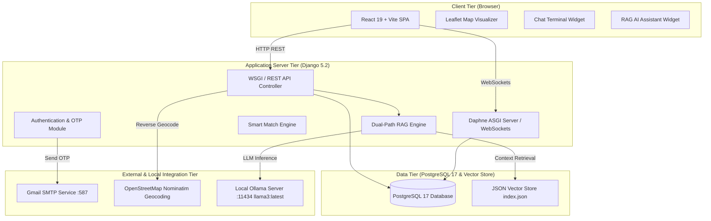
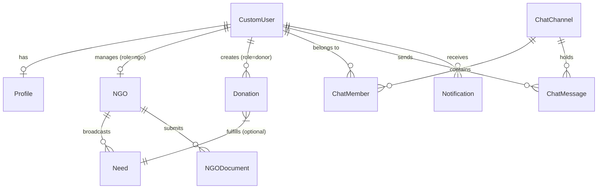
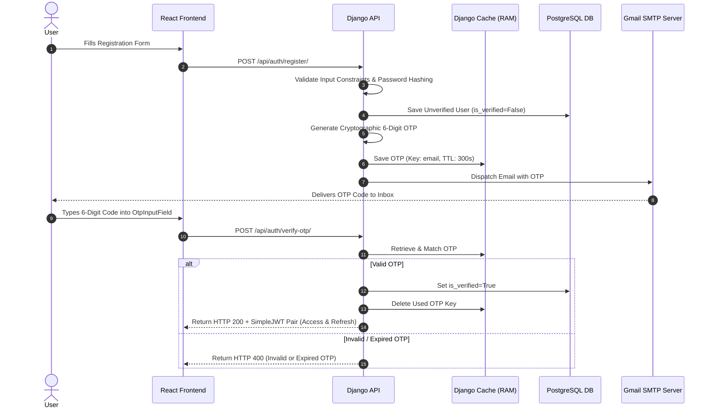
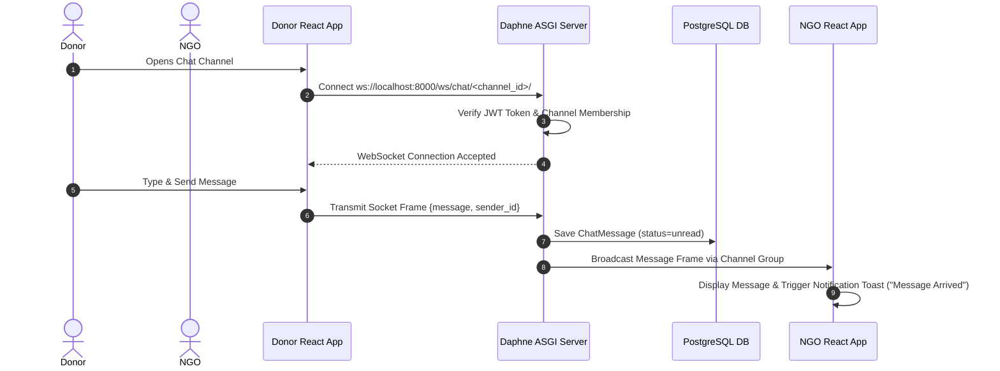

# DonateBridge — System Architecture & Engineering Documentation

This document provides a comprehensive technical overview of the **DonateBridge** system architecture, component relationships, data flow patterns, security mechanisms, and design decisions for local deployment and B.Tech academic evaluation.

---

## 1. High-Level Architecture Overview

DonateBridge is designed as a modular, decoupled full-stack web application. It follows a multi-tier client-server architecture consisting of a React Single-Page Application (SPA) frontend, a Django REST Framework (DRF) backend, an ASGI (Daphne) WebSocket server for real-time communication, a native PostgreSQL database for structured data storage, and a local AI engine (Ollama) providing Retrieval-Augmented Generation (RAG).



---

## 2. Component Architecture Breakdown

### 2.1 Frontend Architecture (`client/`)
The frontend is constructed with **React 19** using **Vite** as the build tool and bundler.

```text
client/src/
├── api/                # Axios HTTP client instance & API endpoints (index.js)
├── components/         # Modular UI components
│   ├── discover/       # Map visualizers & filter bars
│   ├── layout/         # Navbar, Footer, NavigationDrawer
│   └── ui/             # OtpInputField, AiMatchAssistant, Toast, Button
├── context/            # GlobalStateContext (Auth JWT, Sockets, Notifications)
├── pages/              # Primary view pages (AuthSuite, DonorDashboard, NgoConsole, ChatTerminal)
└── App.jsx             # React Router routing definition
```

* **State Management (`GlobalStateContext`):** Manages user session state, JWT tokens, active WebSocket instances, and global toast notifications.
* **API Service Layer (`client/src/api/index.js`):** Centralized Axios configuration equipped with request interceptors to automatically attach JWT Bearer tokens to outgoing HTTP requests.

### 2.2 Backend Architecture (`server/`)
The backend is built on **Django 5.2** and **Django REST Framework (DRF)**, structured into modular apps:

* **`authentication`**: CustomUser model, extended profile tables, JWT token management, 6-digit email OTP cache, and DB seed script (`seed_db`).
* **`ngo`**: NGO organization profiles, government registration document filings (`NGODocument`), Need broadcasts, and emergency campaigns.
* **`donation`**: Physical donation listing offers and the Multi-Factor Smart Match scoring engine.
* **`chat`**: WebSocket consumer (`ChatConsumer`), channels, direct message persistence, and available contact discovery.
* **`ai`**: Ollama LLM integration, custom vector store search, knowledge ingestion command (`ingest_knowledge`), and dual-path RAG processor (`rag_service.py`).
* **`logistics`**: 6-step cargo milestone tracking stream and secure hashed QR token verification.
* **`moderation`**: Admin document audit trail, platform audit logs, and fraud detection radar.
* **`notification`**: User-specific real-time event notification stream.

---

## 3. Database Architecture (PostgreSQL)

DonateBridge relies exclusively on a native **PostgreSQL 17** database instance (`donatebridge_db`).



### Relational Constraints & Keys
* **Primary Keys:** Auto-incrementing BigAutoField or UUIDs on all models.
* **Foreign Keys & Cascade Rules:**
  * `NGO.user` -> `OneToOneField(CustomUser, on_delete=CASCADE)`
  * `Need.ngo` -> `ForeignKey(NGO, on_delete=CASCADE)`
  * `ChatMessage.channel` -> `ForeignKey(ChatChannel, on_delete=CASCADE)`
  * `ChatMessage.sender` -> `ForeignKey(CustomUser, on_delete=CASCADE)`
* **Unique Constraints:** `CustomUser.username`, `CustomUser.email`, `NGO.registration_number`, `NGO.gov_registration_number`.

---

## 4. Authentication & OTP Architecture

DonateBridge enforces a 2-stage verification model for registration and password recovery:



### Security Safeguards
1. **Zero Exposure:** OTP codes are never returned in API payloads or printed to server logs.
2. **Time-To-Live (TTL):** OTPs expire automatically after 5 minutes (300 seconds).
3. **Resend Cooldown:** 60-second rate-limiting rule returns `HTTP 429 Too Many Requests` if resend is requested too quickly.
4. **Attempt Invalidation:** Maximum of 5 incorrect attempts before the code is forcibly purged from cache.

---

## 5. Smart Match Scoring Algorithm

The Smart Match engine (`server/apps/donation/views.py`) deterministically scores verified NGO demands against donor item offers using a multi-factor formula:

$$\text{Total Score} = S_{\text{category}} + S_{\text{distance}} + S_{\text{urgency}} + S_{\text{trust}} + S_{\text{quantity}}$$

| Scoring Factor | Weight / Max Points | Evaluation Logic |
| :--- | :--- | :--- |
| **Category Fit ($S_{\text{category}}$)** | 30 Points | Exact category match = 30 pts; related category = 15 pts. |
| **Distance ($S_{\text{distance}}$)** | 20 Points | Calculated via Haversine formula based on donor pickup coordinates and NGO coordinates. $0\text{ km} = 20\text{ pts}$, declining linearly to $0\text{ pts}$ at $>50\text{ km}$. |
| **Demand Urgency ($S_{\text{urgency}}$)** | 15 Points | `Critical` = 15 pts, `High` = 10 pts, `Medium` = 5 pts, `Low` = 2 pts. |
| **NGO Trust Score ($S_{\text{trust}}$)** | 10 Points | Derived directly from audited NGO Trust Score ($0–100\% \rightarrow 0–10\text{ pts}$). |
| **Quantity Fit ($S_{\text{quantity}}$)** | 25 Points | Ratio of offered quantity vs NGO requested quantity. |

---

## 6. Real-Time Chat Architecture

Real-time communication is facilitated by **Django Channels (Daphne ASGI server)** operating over WebSockets, with REST fallback endpoints.



---

## 7. RAG (Retrieval-Augmented Generation) Architecture

DonateBridge deploys a local RAG engine (`server/apps/ai/services/rag_service.py`) powered by **Ollama (`llama3:latest`)**:

```text
User Question / Prompt
         │
         ▼
Query Classifier
   ├── Knowledge Query? ──► Searches Dense Vector Index (media/vector_store/index.json)
   └── Live Data Query?  ──► Executes Django ORM Queries against PostgreSQL (Needs/NGOs)
         │
         ▼
Context Assembly & Section Cleaning
         │
         ▼
Grounded System Prompt Injection
         │
         ▼
Local Ollama LLM Inference (http://localhost:11434)
         │
         ▼
Clean Response + Grounded Source Citations
```

---

## 8. Deployment & Environment Configuration

### Local Deployment Architecture
```text
Developer Machine / Laptop
├── React Frontend (Vite)        --> Port 5173
├── Django REST Backend (Daphne) --> Port 8000
├── PostgreSQL 17 Server         --> Port 5432 (Database: donatebridge_db)
├── Ollama AI Server             --> Port 11434 (Model: llama3:latest)
└── Gmail SMTP Service           --> Port 587 (TLS Enabled)
```

---

## 9. Security & Data Protection Controls

1. **Role Authorization:** Protected API views verify `request.user.role` from database records.
2. **Password Security:** Hashed using PBKDF2 with SHA256.
3. **Cross-Origin Resource Sharing (CORS):** Restricted explicitly to `FRONTEND_URL` (`http://localhost:5173`).
4. **Environment Isolation:** All passwords, tokens, and keys are stored in `server/.env` (excluded from Git via `.gitignore`).
