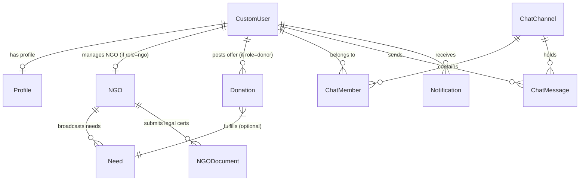

# DonateBridge — Database Architecture & Schema Reference

This document provides a detailed specification of the **PostgreSQL 17** relational database schema, Django ORM models, field definitions, foreign key relationships, database constraints, and management commands for DonateBridge.

---

## 1. Database Overview

* **DBMS:** PostgreSQL Server 17 (Local Native Database Installation)
* **Database Name:** `donatebridge_db`
* **Default Host & Port:** `localhost:5432`
* **ORM:** Django Object-Relational Mapping (ORM) v5.2
* **Python Database Driver:** `psycopg2-binary` (v2.9.10)
* **GUI Management Tool:** pgAdmin 4 / `psql` CLI

---

## 2. Entity-Relationship (ER) Diagram



---

## 3. Table Specifications & Models

### 3.1 `authentication_customuser`
Stores account login credentials and primary user role classification.

| Column | Type | Constraints | Description |
| :--- | :--- | :--- | :--- |
| `id` | BigInt | Primary Key, Auto-Increment | Unique User ID |
| `username` | VarChar(150) | Unique, NOT NULL | Account Username |
| `email` | VarChar(254) | Unique, NOT NULL | User Email Address |
| `password` | VarChar(128) | NOT NULL | PBKDF2 SHA256 Password Hash |
| `role` | VarChar(20) | Choice: `donor`, `ngo`, `admin` | User Platform Access Role |
| `is_verified` | Boolean | Default: `False` | Email OTP Verification Flag |
| `avatar` | VarChar(500) | NULL | User Avatar Image URL |
| `date_joined` | DateTime | NOT NULL | Timestamp of account creation |

---

### 3.2 `authentication_profile`
Stores extended user profile information and GPS coordinates.

| Column | Type | Constraints | Description |
| :--- | :--- | :--- | :--- |
| `id` | BigInt | Primary Key, Auto-Increment | Unique Profile ID |
| `user_id` | BigInt | OneToOne -> `CustomUser.id` (CASCADE) | Associated Account |
| `phone` | VarChar(10) | Regex: `^[6-9]\d{9}$` | 10-Digit Mobile Number |
| `address` | Text | NULL | Street Address |
| `city` | VarChar(100) | NULL | City Name |
| `state` | VarChar(100) | NULL | State Name |
| `district` | VarChar(100) | NULL | District Name |
| `pin_code` | VarChar(6) | Regex: `^[1-9]\d{5}$` | Postal Pincode |
| `lat` | Double Precision| Bounded: -90.0 to 90.0 | Latitude Coordinate |
| `lng` | Double Precision| Bounded: -180.0 to 180.0 | Longitude Coordinate |

---

### 3.3 `ngo_ngo`
Stores organization details for registered non-governmental organizations.

| Column | Type | Constraints | Description |
| :--- | :--- | :--- | :--- |
| `id` | BigInt | Primary Key, Auto-Increment | Unique NGO ID |
| `user_id` | BigInt | OneToOne -> `CustomUser.id` (CASCADE) | NGO Account Manager |
| `name` | VarChar(200) | NOT NULL | Organization Name |
| `registration_number`| VarChar(100) | Unique, NOT NULL | NGO Registration ID |
| `gov_registration_number`| VarChar(100) | Unique, NOT NULL | Government DARPAN / Trust ID |
| `verification_status`| VarChar(20) | Choice: `pending`, `approved`, `rejected` | Verification Status |
| `trust_score` | Integer | Range: 0 to 100, Default: 50 | NGO Platform Trust Score |
| `city` | VarChar(100) | NOT NULL | City Location |
| `state` | VarChar(100) | NOT NULL | State Location |
| `lat` | Double Precision| Bounded: -90.0 to 90.0 | Office Latitude |
| `lng` | Double Precision| Bounded: -180.0 to 180.0 | Office Longitude |

---

### 3.4 `ngo_ngodocument`
Stores legal verification certificate filings uploaded by NGOs.

| Column | Type | Constraints | Description |
| :--- | :--- | :--- | :--- |
| `id` | BigInt | Primary Key, Auto-Increment | Document File ID |
| `ngo_id` | BigInt | ForeignKey -> `NGO.id` (CASCADE) | Associated NGO |
| `doc_type` | VarChar(50) | Choice: `govRegCert`, `fcraCert`, `pan80G` | Legal Document Type |
| `file_url` | VarChar(500) | NOT NULL | Uploaded Document Storage URL |
| `uploaded_at` | DateTime | NOT NULL | Filing Timestamp |

---

### 3.5 `ngo_need`
Stores requirement broadcasts posted by verified NGOs.

| Column | Type | Constraints | Description |
| :--- | :--- | :--- | :--- |
| `id` | BigInt | Primary Key, Auto-Increment | Demand Requirement ID |
| `ngo_id` | BigInt | ForeignKey -> `NGO.id` (CASCADE) | Publishing NGO |
| `item` | VarChar(200) | NOT NULL | Required Item Name |
| `category` | VarChar(100) | Choice: `clothing`, `food`, `books`, `electronics`, `medical`, `other` | Item Category |
| `quantity` | Integer | Strictly Positive (`> 0`) | Target Requested Quantity |
| `fulfilled_quantity`| Integer | Default: 0 | Quantity Received So Far |
| `urgency` | VarChar(20) | Choice: `Low`, `Medium`, `High`, `Critical` | Requirement Urgency Level |
| `status` | VarChar(20) | Choice: `ACTIVE`, `FULFILLED`, `CANCELLED` | Need Status |

---

### 3.6 `donation_donation`
Stores physical item donation offers posted by donors.

| Column | Type | Constraints | Description |
| :--- | :--- | :--- | :--- |
| `id` | BigInt | Primary Key, Auto-Increment | Donation Listing ID |
| `donor_id` | BigInt | ForeignKey -> `CustomUser.id` (CASCADE) | Offering Donor Account |
| `need_id` | BigInt | ForeignKey -> `Need.id` (NULLable) | Matched NGO Need (optional) |
| `item_name` | VarChar(200) | NOT NULL | Item Name |
| `category` | VarChar(100) | NOT NULL | Item Category |
| `quantity` | Integer | Strictly Positive (`> 0`) | Quantity Offered |
| `pickup_lat` | Double Precision| Bounded: -90.0 to 90.0 | Pickup Point Latitude |
| `pickup_lng` | Double Precision| Bounded: -180.0 to 180.0 | Pickup Point Longitude |
| `status` | VarChar(20) | Choice: `AVAILABLE`, `CLAIMED`, `DELIVERED` | Offer Status |

---

### 3.7 `chat_chatchannel`, `chat_chatmember`, & `chat_chatmessage`
Stores text chat threads, authorized members, and message history.

* **`chat_chatchannel`**: Stores unique channel thread identifiers (`channel_type`).
* **`chat_chatmember`**: Links `user_id` to `channel_id` with `role` permissions.
* **`chat_chatmessage`**: Stores `sender_id`, `content`, `timestamp`, and `is_read` status.

---

## 4. PostgreSQL Configuration & Commands

### 4.1 Creating the Database
```sql
CREATE DATABASE donatebridge_db;
```

### 4.2 Database Migrations Command Sequence
```bash
cd server
python manage.py makemigrations
python manage.py migrate
```

### 4.3 Database Seeding & Verification Command
```bash
python manage.py seed_db
```

This populates initial test accounts (`admin`, `donortest`, `hopefoundation`) and sample needs centered around Nagpur, Maharashtra.
