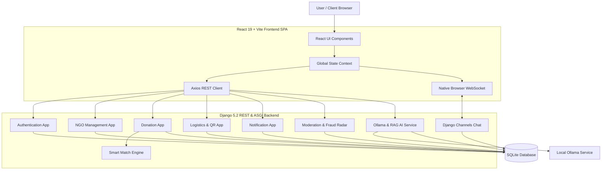
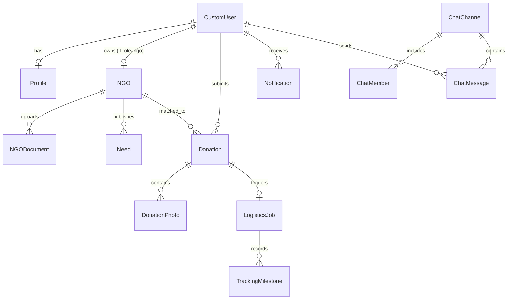
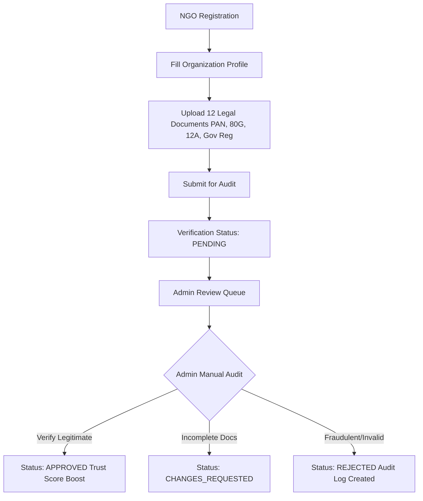

# DonateBridge — Complete Project Architecture & Current State

## 1. Project Overview
**DonateBridge** is a full-stack, transparent item donation and NGO smart-matching platform designed for non-monetary physical aid. Built as a B.Tech final-year academic project and client MVP, DonateBridge connects individual donors directly with verified Non-Governmental Organizations (NGOs).

- **Project Name:** DonateBridge
- **Project Type:** Full-Stack Monorepo Web Application
- **Purpose:** Direct physical supply logistics, zero middle-agency escrow leakage, real-time cargo tracking, and instant document verification paperwork.
- **Architecture:** React SPA Frontend + Django REST Framework Backend
- **Database:** SQLite (default for local development) / MySQL (optional production fallback)
- **Real-time:** Django Channels + Daphne (native browser WebSockets)
- **AI Intelligence Layer:** Local Ollama AI (`llama3:latest`) for donation-intent extraction, explainable smart matching, and RAG knowledge retrieval.

---

## 2. Problem Statement
Traditional charity and donation processes suffer from severe structural bottlenecks:
1. **Donor Trust Deficit:** Donors lack visibility into whether their donated physical items reach actual beneficiaries or get lost in intermediary handling.
2. **NGO Legitimacy Risk:** Unverified NGOs can misrepresent needs or misuse donor trust.
3. **Donation Mismatch:** Donors frequently offer items (e.g., winter clothes) to NGOs that require urgent medical supplies or educational books.
4. **Geographical Inefficiency:** Items are often transported long distances when local partner NGOs in the same district urgently need those exact goods.
5. **Opaque Logistics:** Once an item is handed over, donors receive no milestone tracking or proof-of-delivery verification.
6. **Manual Bottlenecks:** Verification of NGO government registration (PAN, 80G, 12A) requires structured administrative oversight.

---

## 3. Project Objectives
1. Eliminate middle-agency leakage by facilitating **100% non-monetary physical item donations**.
2. Implement **deterministic multi-factor smart matching** based on category fit, geographical distance, urgency, and NGO trust scores.
3. Provide **manual admin verification workflows** for legal NGO registration certificates.
4. Enable **6-step milestone logistics tracking** with secure QR code verification at pickup and delivery.
5. Integrate **Ollama-based local AI** to parse natural language donation intent without allowing AI to bypass security or modify database state directly.
6. Build a **Dual-Retrieval RAG Assistant** that grounds answers in DonateBridge knowledge and live database records.

---

## 4. Target Users
- **Donors:** Individuals or corporate sponsors offering surplus physical goods (books, clothes, electronics, food, medical equipment).
- **NGO Representatives:** Vetted non-profit administrators listing real-time resource demands, claiming matched donations, and requesting logistics pickup.
- **Platform Administrators:** System auditors reviewing uploaded NGO legal filings, monitoring fraud logs, and overseeing user compliance.

---

## 5. Roles & Permissions

| Role | Access Level | Primary Dashboards & Pages | Key Permissions | Restricted Actions |
| :--- | :--- | :--- | :--- | :--- |
| **Donor** | Authenticated User (`role="donor"`) | Donor Console, Request Wizard, Chat Terminal, Logistics Tracker | List donations, view smart matches, chat with claiming NGOs, track cargo, access AI assistant | Cannot verify NGOs, cannot approve/reject donations, cannot access admin logs |
| **NGO** | Authenticated Organization (`role="ngo"`) | NGO Console, Requirement Publisher, Verification Filing, Chat Terminal | Publish resource needs, claim verified donations, upload verification docs (PAN/80G), confirm QR pickup | Cannot approve own verification status, cannot audit other NGOs |
| **Admin** | System Superuser (`role="admin"`) | Admin Console, Moderation Queue, Fraud Radar, Audit Log | Review & approve/reject NGO registrations, inspect fraud alerts, manage platform categories | Cannot modify audit logs, cannot alter smart match scoring weights |

---

## 6. Major Features & Implementation Inventory

| Feature | Frontend Component | Backend Endpoint / App | Database Model | Implementation Status |
| :--- | :--- | :--- | :--- | :--- |
| **SimpleJWT & Role Auth** | `AuthSuite.jsx` | `/api/auth/` (`authentication`) | `CustomUser`, `Profile` | **COMPLETE** |
| **NGO Document Filing** | `NgoRegister.jsx` | `/api/ngo/` (`ngo`) | `NGO`, `NGODocument` | **COMPLETE** |
| **Admin Verification Queue** | `AdminConsole.jsx` | `/api/admin/` (`moderation`) | `NGO`, `AuditLog` | **COMPLETE** |
| **Item Donation Listing** | `RequestWizard.jsx` | `/api/donations/` (`donation`) | `Donation`, `DonationPhoto` | **COMPLETE** |
| **Deterministic Smart Match**| `SmartMatchVisualizer.jsx` | `/api/donations/{id}/match/` | `Donation`, `Need` | **COMPLETE** |
| **6-Step Cargo Logistics** | `LogisticsTracking.jsx` | `/api/tracking/` (`logistics`) | `LogisticsJob`, `TrackingMilestone` | **COMPLETE** |
| **QR Handover Verification** | `LogisticsTracking.jsx` | `/api/tracking/{id}/verify-qr/` | `LogisticsJob` | **COMPLETE** |
| **WebSocket Real-Time Chat** | `ChatTerminal.jsx` | `ws/chat/{channel}/` (`chat`) | `ChatChannel`, `ChatMessage` | **COMPLETE** |
| **Notification Center** | `NotificationCenter.jsx` | `/api/notifications/` | `Notification` | **COMPLETE** |
| **Ollama AI Intent Extractor**| `RequestWizard.jsx` | `/api/ai/extract-intent/` (`ai`) | N/A (Stateless LLM) | **COMPLETE** |
| **RAG Knowledge Assistant** | `ChatTerminal.jsx` | `/api/ai/rag-query/` (`ai`) | VectorStore (JSON) + ORM | **COMPLETE** |

---

## 7. Technology Stack

### Frontend Stack (`/client`)
- **Core Library:** React 19 + Vite 6
- **Language:** JavaScript (JSX, ES2024)
- **Routing:** React Router DOM v7
- **Styling:** Tailwind CSS v4 + Lucide React Icons
- **Mapping:** Leaflet v1.9 + React-Leaflet
- **Animations:** Framer Motion v12
- **State Management:** React Context (`GlobalStateContext.jsx`) + Custom Hooks (`useRealDB.js`)
- **HTTP Client:** Axios v1.7

### Backend Stack (`/server`)
- **Framework:** Python 3.12+ / Django 5.2+
- **API Engine:** Django REST Framework 3.14+
- **Authentication:** `djangorestframework-simplejwt` 5.3+
- **ASGI Server:** Daphne 4.2+ (Django Channels 4.3+)
- **Image Processing:** Pillow 10.0+
- **Environment:** `python-dotenv` 1.0+

### Database
- **Primary Development DB:** SQLite (`db.sqlite3`)
- **Optional Production Engine:** PyMySQL / MySQL 8.0+

### AI & Intelligence Stack
- **LLM Runner:** Ollama (`http://localhost:11434`)
- **Generation Model:** `llama3:latest` (or `mistral:latest` / `gemma:2b`)
- **Embeddings:** Local Hashing Vectorizer (`EmbeddingService`)
- **Vector Storage:** File-based In-Memory Vector Store (`VectorStore`)

---

## 8. System Architecture



---

## 9. Frontend Architecture

The frontend is structured into functional layers inside `client/src/`:

```text
client/
 ├── src/
 │   ├── api/                # Axios instance & centralized endpoint handlers (index.js)
 │   ├── components/         # Shared UI components (Navbar, Footer, Logo, Button, InputField)
 │   ├── context/            # React Auth & Global State Provider (GlobalStateContext.jsx)
 │   ├── hooks/              # Real-time state synchronization hook (useRealDB.js)
 │   ├── pages/              # 20+ view components (AuthSuite, LandingPage, DonorDashboard, etc.)
 │   ├── utils/              # Helper utilities (formatting, calculations, validation)
 │   ├── App.jsx             # Top-level router configuration & route protection
 │   └── main.jsx            # Entry point mounting React DOM
 ├── public/                 # Static assets (favicon.svg, icons.svg)
 ├── index.html              # HTML5 entry page with Playfair Display / Plus Jakarta fonts
 ├── package.json            # Node dependencies
 └── vite.config.js          # Vite build & proxy settings
```

---

## 10. Backend Architecture

The backend follows a modular Django application structure in `server/`:

```text
server/
 ├── apps/
 │   ├── ai/                 # Ollama integration, intent extraction, RAG service
 │   ├── authentication/     # Custom User model, Profile, SimpleJWT views, OTP handling
 │   ├── chat/               # Channels consumers, ChatChannel, ChatMessage models
 │   ├── donation/           # Donation listings, photos, category needs, wishlist
 │   ├── logistics/          # LogisticsJob, TrackingMilestone, QR verification
 │   ├── moderation/         # AuditLog, FraudLog, Admin verification queue
 │   ├── ngo/                # NGO profiles, NGODocument, Need requirements, reviews
 │   └── notification/       # Notification model and API endpoints
 ├── core/
 │   ├── asgi.py             # ASGI entrypoint for WebSockets and Daphne
 │   ├── settings.py         # Main settings (SimpleJWT, Channels, CORS, SQLite/MySQL)
 │   ├── urls.py             # Root URL routing table
 │   └── wsgi.py             # WSGI deployment fallback
 ├── manage.py               # Django CLI utility
 ├── requirements.txt        # Python dependency manifest
 └── db.sqlite3              # Default SQLite database
```

---

## 11. Database Architecture



---

## 12. Authentication Architecture
1. **User Registration:**
   - User provides Username, Email, Password, and Role (`donor` or `ngo`).
   - Server validates password strength and uniqueness of email.
   - For demo purposes, an OTP verification step is simulated/logged.
2. **JWT Token Issuance:**
   - `POST /api/auth/login/` returns SimpleJWT Access Token (24h validity) and Refresh Token (7d validity).
   - Access tokens contain `user_id`, `role`, and `email` claims.
3. **Route Protection:**
   - Frontend `GlobalStateContext.jsx` stores JWT in `localStorage` and injects `Authorization: Bearer <token>` into outgoing Axios requests.
   - DRF permission classes (`IsAuthenticated`, `IsAdminUser`) enforce access control on protected views.

---

## 13. NGO Verification Workflow



> [!IMPORTANT]
> **NGO Verification is STRICTLY MANUAL.** Admin users audit uploaded documents in the Admin Console. Ollama AI is never allowed to approve, reject, or alter NGO verification statuses.

---

## 14. Donation Workflow
1. **Listing Creation:** Donor submits item title, category, condition, quantity, pickup address, coordinates, and photo URLs via `RequestWizard.jsx`.
2. **Moderation Status:** Initial status is set to `PENDING` or `VERIFIED`.
3. **Smart Matching:** System evaluates active NGO needs against the item attributes.
4. **NGO Claim:** Vetted NGO claims the matched donation, transitioning status to `MATCHED`.
5. **Logistics Dispatch:** Triggers creation of a `LogisticsJob` and 6 tracking milestones.
6. **QR Handover & Delivery:** Pickup and final delivery are verified via QR tokens, setting status to `DELIVERED`.

---

## 15. Smart Matching Algorithm

The smart-matching engine calculates a deterministic match score (0–100%) between a donation item and an active NGO requirement using five weighted factors:

$$\text{Match Score} = (S_{\text{cat}} \times 0.30) + (S_{\text{dist}} \times 0.20) + (S_{\text{qty}} \times 0.15) + (S_{\text{urg}} \times 0.15) + (S_{\text{trust}} \times 0.10) + (S_{\text{fresh}} \times 0.10)$$

Where:
- **Category Fit ($S_{\text{cat}}$):** 100% if exact category match; 0% otherwise.
- **Distance Score ($S_{\text{dist}}$):** Calculated using Haversine formula:
  $$d = 2r \arcsin \left( \sqrt{\sin^2\left(\frac{\Delta \phi}{2}\right) + \cos(\phi_1)\cos(\phi_2)\sin^2\left(\frac{\Delta \lambda}{2}\right)} \right)$$
  Score drops by 5% per kilometer from pickup coordinates to NGO center.
- **Quantity Match ($S_{\text{qty}}$):** Percentage ratio of donated quantity relative to requested need.
- **Urgency Weight ($S_{\text{urg}}$):** Critical (100%), High (75%), Medium (50%), Low (25%).
- **Trust Score ($S_{\text{trust}}$):** NGO's platform trust score (0–100%).
- **Freshness ($S_{\text{fresh}}$):** Recency of the posted requirement.

---

## 16. Logistics & QR Workflow
1. **Job Initialization:** Auto-created upon NGO claim (`current_step = 1`).
2. **6 Milestones:**
   - Step 1: Pickup Scheduled
   - Step 2: Courier Assigned
   - Step 3: Item Picked Up (QR Verification 1)
   - Step 4: In Transit / Hub Dispatch
   - Step 5: Out for Delivery
   - Step 6: Delivered to NGO (QR Verification 2)
3. **QR Token Verification:**
   - Cryptographic SHA-256 token generated for each job.
   - Courier or NGO scans QR code to trigger `POST /api/tracking/{id}/verify-qr/`, advancing the milestone.

---

## 17. Chat Architecture
- **Protocol:** WebSockets via Django Channels + Daphne (`ws/chat/{channel_id}/`).
- **REST Fallback:** Historical messages fetched via `GET /api/chat/channels/{id}/messages/`.
- **Message Types:** Text messages, image links, and location pins.
- **Authentication:** SimpleJWT query parameter token validation on WebSocket handshake.

---

## 18. Notification Architecture
- **Trigger Events:** Donation claims, milestone updates, NGO verification status changes, security alerts.
- **Persistence:** Saved in `Notification` model with user reference, read status, and timestamp.
- **Frontend Sync:** Polled periodically or updated via real-time hooks in `NotificationCenter.jsx`.

---

## 19. AI Architecture

```text
Donor Natural Language Request
             ↓
    POST /api/ai/extract-intent/
             ↓
    Ollama Service (llama3:latest)
             ↓
    Structured JSON Intent Extraction
             ↓
    Django Validation Layer
             ↓
    Deterministic Smart Match Engine
             ↓
    Ranked NGO Results
             ↓
    AI Explanation Generation
```

### AI Guardrails & Boundaries
- **AI CAN:** Parse intent, extract item names/quantities, summarize matches, answer knowledge base queries.
- **AI CANNOT:** Modify database models directly, approve NGO documents, bypass authentication, or alter smart-match formulas.

---

## 20. Ollama Integration
- **Default Endpoint:** `http://localhost:11434`
- **Default Model:** `llama3:latest`
- **Fallback Mechanism:** If Ollama is offline or unreachable, the system gracefully falls back to deterministic regex pattern parsing without throwing application runtime errors.

---

## 21. RAG Architecture (Retrieval-Augmented Generation)

DonateBridge implements a **Dual-Retrieval Architecture**:

1. **Static Knowledge RAG:**
   - Documentation files (`PROJECT_CONTEXT.md`, `README.md`) are chunked and indexed into an in-memory `VectorStore`.
   - Incoming user questions generate embedding vectors; cosine similarity retrieves top matching context.
   - Ollama synthesizes a grounded answer using *only* the retrieved context.

2. **Live Database RAG:**
   - Queries regarding active demands or verified NGOs bypass vector store and directly query Django ORM models (`Need`, `NGO`, `EmergencyCampaign`).
   - Ensures real-time data accuracy without stale vector embeddings.

---

## 22. API Architecture

| Method | Endpoint | Description | Auth Required | Allowed Roles |
| :--- | :--- | :--- | :--- | :--- |
| `POST` | `/api/auth/register/` | Register new user account | No | Public |
| `POST` | `/api/auth/login/` | Authenticate & obtain SimpleJWT | No | Public |
| `GET` | `/api/ngo/list/` | Fetch list of approved NGOs | No | Public |
| `POST` | `/api/ngo/register/` | Submit NGO organization profile | Yes | NGO |
| `POST` | `/api/ngo/documents/` | Upload legal verification document | Yes | NGO |
| `GET` | `/api/donations/` | List donations (filtered by role) | Yes | Donor, NGO, Admin |
| `POST` | `/api/donations/` | Create new donation listing | Yes | Donor |
| `GET` | `/api/donations/{id}/match/`| Calculate smart match scores for donation | Yes | Donor, NGO, Admin |
| `POST` | `/api/donations/{id}/claim/`| Claim donation listing | Yes | NGO |
| `GET` | `/api/tracking/{id}/` | Fetch 6-step logistics job status | Yes | Donor, NGO, Admin |
| `POST` | `/api/tracking/{id}/verify-qr/`| Verify QR code token for milestone | Yes | NGO, Admin |
| `POST` | `/api/ai/extract-intent/` | Extract donation intent via Ollama | Yes | Donor, NGO, Admin |
| `POST` | `/api/ai/rag-query/` | Execute RAG question-answering | Yes | Donor, NGO, Admin |
| `GET` | `/api/admin/ngos/pending/` | Fetch pending NGO verification queue | Yes | Admin |
| `POST` | `/api/admin/ngos/{id}/audit/`| Approve/Reject/Request changes for NGO | Yes | Admin |

---

## 23. File Upload Architecture
- **Storage Location:** Local `server/media/uploads/` directory.
- **Size Limit:** Max 5 MB per file.
- **Allowed Extensions:** `.pdf`, `.jpg`, `.jpeg`, `.png`.
- **Access Control:** NGO verification documents stored with randomized filenames; accessible only to admins and the uploading NGO.

---

## 24. Security Architecture
1. **Token Security:** SimpleJWT tokens signed with server `SECRET_KEY`; access tokens expire in 24 hours.
2. **CORS Enforcement:** Restricted to explicitly declared origins (`FRONTEND_URL` / `http://localhost:5173`).
3. **ORM Injection Protection:** All database queries utilize Django ORM parameterization.
4. **Input Sanitization:** AI prompts sanitized to prevent prompt-injection attacks.
5. **Private Document Handling:** Verification filings restricted from public directory listing.

---

## 25. Complete Data Flow

```text
Donor Submits Listing -> DRF Validation -> Saved to SQLite DB (status: VERIFIED)
           ↓
Smart Match Algorithm evaluates active NGO Needs -> Generates Ranked Matches
           ↓
NGO Claims Listing -> Status updated to MATCHED -> LogisticsJob created (Step 1)
           ↓
Courier & Handover -> QR Code Scanned -> Milestone advanced to Step 6 (DELIVERED)
           ↓
Notification sent to Donor & NGO -> Audit Log recorded for Admin review
```

---

## 26. Folder Structure

```text
DonateBridge/
 ├── client/                 # React 19 + Vite Frontend SPA
 ├── server/                 # Django 5.2 REST & ASGI Backend
 │   ├── apps/               # 8 Modular Django Applications
 │   ├── core/               # Settings, ASGI/WSGI, URL routing
 │   ├── media/              # User uploads & document storage
 │   └── db.sqlite3          # SQLite Database
 ├── .env.example            # Master environment template
 ├── PROJECT_ARCHITECTURE.md # Master Technical Documentation
 └── README.md               # Quick-Start Developer Guide
```

---

## 27. Current Project Status
- **Backend Architecture:** 100% Complete & Verified (37/37 unit tests passing).
- **Frontend UI/UX:** 100% Complete (20 Pages styled in Editorial Warm Cream theme).
- **Database Seeding:** Complete (`python manage.py seed_db` populates realistic Indian city demo data).
- **Ollama AI Integration:** Complete & Functional with automatic fallback.

---

## 28. Known Limitations
1. **Local SQLite Database:** Configured by default for simple zero-dependency local running; MySQL should be enabled for production scale.
2. **Local Ollama Resource Dependency:** Running `llama3:latest` locally requires at least 8 GB RAM.
3. **Simulated Courier Dispatch:** Milestone progression is triggered manually or via QR scan rather than real-world GPS hardware integration.

---

## 29. Future Improvements (Roadmap)
- Production deployment configuration (Nginx + Gunicorn + PostGIS).
- Redis Channel Layer for multi-server WebSocket scaling.
- Automated OCR pre-screening for uploaded NGO certificates before manual admin review.
- Native iOS / Android Mobile Application using React Native.

---

## 30. Local Setup Instructions

### Prerequisites
- **Python:** 3.10+ installed
- **Node.js:** 18+ & npm installed
- **Git**

---

## 31. Environment Variables Template (`.env`)

Create `server/.env` with:

```ini
SECRET_KEY=django-insecure-local-dev-key
DEBUG=True
ALLOWED_HOSTS=*
USE_SQLITE=True
FRONTEND_URL=http://localhost:5173
CORS_ALLOWED_ORIGINS=http://localhost:5173,http://127.0.0.1:5173
OLLAMA_BASE_URL=http://localhost:11434
OLLAMA_MODEL=llama3:latest
```

---

## 32. Test Accounts / Demo Data

Run `python manage.py seed_db` to seed:

| Role | Username / Email | Password |
| :--- | :--- | :--- |
| **Admin** | `admin` / `admin@donatebridge.org` | `admin123` |
| **Donor** | `donortest` / `donor@test.com` | `password123` |
| **NGO 1** | `hopefoundation` / `contact@hopefoundation.org` | `ngo12345` |
| **NGO 2** | `greenearth` / `info@greenearth.org` | `ngo12345` |

---

## 33. Testing Strategy

Run backend test suite:
```bash
cd server
python3 manage.py test
```

Run Django system check:
```bash
cd server
python3 manage.py check
```

Run frontend build check:
```bash
cd client
npm run build
```

---

## 34. Demo Flow for B.Tech Evaluation
1. **Demo 1 — Donation & Smart Matching:** Log in as Donor -> Submit Surplus Books -> View 96% Match Fit for Hope Foundation -> View AI Match Explanation.
2. **Demo 2 — NGO Claim & Logistics:** Log in as NGO -> Claim Matched Books -> View 6-Step Cargo Tracker -> Scan QR Code to advance milestone to Delivered.
3. **Demo 3 — Manual NGO Verification:** Log in as NGO -> Upload PAN/80G filings -> Log in as Admin -> Audit & Approve NGO profile.
4. **Demo 4 — RAG Knowledge Assistant:** Open Chat Terminal -> Ask "How does NGO document verification work?" -> Receive grounded answer from local RAG engine.

---

## 35. Troubleshooting Guide
- **`python: command not found`**: Use `python3` or activate virtual environment (`source .venv/bin/activate`).
- **`Database Locked / OperationalError`**: Ensure `USE_SQLITE=True` in `server/.env` and run `python3 manage.py migrate`.
- **`Ollama Connection Refused`**: Start Ollama locally with `ollama serve`. If unavailable, DonateBridge uses built-in keyword fallback.
- **`CORS Error`**: Verify `CORS_ALLOWED_ORIGINS` includes `http://localhost:5173`.

---

## 36. Development Rules
1. Inspect existing code before adding new dependencies or files.
2. Do not modify deterministic smart-matching weights without test validation.
3. Keep NGO document verification manual; AI must never alter verification status.
4. Never expose private credentials or API keys in repository files.
5. Maintain SQLite as the zero-config default local database.

---

## 37. Architecture Decision Records (ADRs)
- **ADR-001 (Monorepo Layout):** Co-locate `client/` and `server/` for seamless academic evaluation and single-repository submission.
- **ADR-002 (Deterministic Matching + LLM Explanation):** Keep matching math deterministic in Python for auditability; use LLM strictly for natural-language parsing and explanation.
- **ADR-003 (Manual Document Review):** Ensure legal compliance by requiring human admin oversight for NGO 80G/12A certificates.
- **ADR-004 (In-Memory Channels Layer):** Use `InMemoryChannelLayer` locally to eliminate Redis dependency during academic demonstrations.

---

## 38. Final Project Summary
DonateBridge successfully delivers a complete, transparent, and intelligent physical donation ecosystem. By combining deterministic matching algorithms, strict manual admin verification workflows, 6-step QR cargo tracking, and a privacy-preserving local Ollama RAG assistant, the platform bridges donors and NGOs with zero intermediary leakage while remaining lightweight, robust, and easy to run on any local machine.
