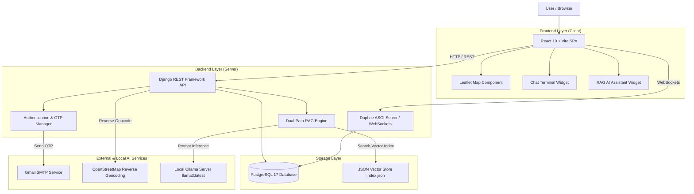
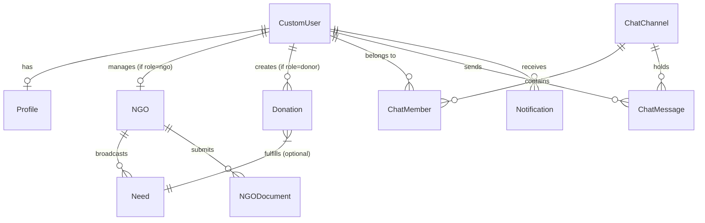

# DonateBridge

> A Digital Donation and Donor–NGO/Foundation Collaboration Platform with Secure Authentication, Location Intelligence, Real-Time Communication, RAG, and Local AI Assistance.

---

## 📌 Project Overview

**DonateBridge** is a full-stack, AI-assisted non-monetary physical item donation and donor–organization collaboration platform. It bridges the gap between individual donors and vetted Non-Governmental Organizations (NGOs) or Charitable Foundations.

In many communities, donors possess surplus physical goods—such as clothing, winter blankets, unexpired packaged food, educational books, electronics, and household furniture—while nearby NGOs face urgent resource shortages to support vulnerable populations. DonateBridge provides a centralized digital bridge to coordinate these non-monetary contributions efficiently.

The system incorporates:
* **Secure OTP Authentication:** 6-digit email OTP verification via Gmail SMTP to guarantee verified identity during registration and password reset.
* **Role-Based Access:** Distinct workflows for Donors, NGOs/Foundations, and Administrators.
* **Smart Match Recommendation Engine:** Deterministic scoring algorithm ranking verified NGO requirements based on category match, proximity (GPS coordinates), demand urgency, and trust index.
* **Location Intelligence:** Coordinate-based location selection, Leaflet interactive map picking, and reverse-geocoding via OpenStreetMap API.
* **Real-Time Communication:** Direct peer-to-peer text messaging and channel discovery via WebSockets (Daphne/Channels) and REST fallback.
* **Local Dual-Retrieval RAG & AI Assistance:** Local Ollama integration (`llama3:latest`) combined with grounded Retrieval-Augmented Generation (RAG) over vector-indexed platform documentation and live PostgreSQL records.

---

## 🎯 Problem Statement

Traditional non-monetary donation workflows suffer from several systemic inefficiencies:

1. **Fragmented Connection & Discovery:** Donors struggle to find legitimate, verified NGOs near their location that actively need specific non-monetary items.
2. **Lack of Direct Coordination:** Without built-in communication tools, donors and NGOs face delays and friction when agreeing on item condition, pickup timing, and handover locations.
3. **Information Asymmetry & Verification Concerns:** Donors hesitate to contribute due to concerns regarding organization authenticity and lack of official document verification.
4. **Uncoordinated Demand & Resource Waste:** NGOs often receive unsolicited, low-priority items while critical shortages (such as winter blankets or emergency food rations) remain unfulfilled.
5. **Complex User Onboarding:** Platforms often lack accessible, grounded user guidance to help non-technical users navigate verification rules, tracking steps, and platform policies.

DonateBridge solves these challenges through a unified platform that combines verified NGO onboarding, deterministic smart matching, location intelligence, real-time text chat, and grounded AI assistance.

---

## 💡 Proposed Solution

DonateBridge addresses these challenges by establishing an end-to-end digital coordination flow:

```text
               User Registration
                      ↓
           Email 6-Digit OTP Verification
                      ↓
             Role Assignment (Donor / NGO)
                      ↓
        ┌─────────────┴─────────────┐
        ▼                           ▼
  Donor Dashboard              NGO Console
  • Post Item Offer            • Broadcast Demand / Need
  • Discover NGOs              • View Matched Offers
        │                           │
        └─────────────┬─────────────┘
                      ↓
            Smart Match Algorithm
         (Category, Distance, Urgency)
                      ↓
        Location-Based Map Discovery
                      ↓
      Donor ↔ NGO/Foundation Chat System
           (Direct Text & Coordinate Share)
                      ↓
     Physical Handover Coordination & Feedback
                      ↓
       Grounded RAG / Ollama AI Assistant
```

---

## 📋 Objectives

The primary academic and technical objectives of DonateBridge include:

* **Centralized Platform:** Build a responsive web platform connecting donors with verified NGOs and foundations.
* **Secure Account Access:** Implement dual-stage registration with cryptographically secure 6-digit email OTP verification.
* **Role-Based Security:** Enforce backend role checks for Donors, NGOs, and System Administrators.
* **Deterministic Smart Matching:** Develop a multi-factor ranking algorithm prioritizing NGO needs by category fit, distance (haversine formula), demand urgency, and NGO trust score.
* **Location Intelligence:** Integrate GPS coordinate storage, Leaflet map selection, and Nominatim reverse-geocoding.
* **Direct Real-Time Chat:** Provide WebSocket-enabled text messaging for direct donor–NGO coordination.
* **Local Grounded AI:** Deploy a local Ollama LLM (`llama3:latest`) with a dual-retrieval RAG engine over platform documentation and live database tables.
* **Relational Data Integrity:** Store all application data natively in PostgreSQL with strict model constraints and Django REST Framework validation.
* **Administrative Audit:** Provide a Django Admin console and moderation endpoints for auditing NGO registration documents and managing platform integrity.

---

## 🔬 Scope of the Project

### Included Functionality
* Donor and NGO user account registration and profile management.
* Gmail SMTP 6-digit email OTP verification with rate limiting and expiration.
* NGO legal document upload and verification audit workflow.
* NGO Need broadcasting (item, quantity, category, urgency).
* Item donation listing and Smart Match scoring.
* Coordinate-based location picking, Leaflet map integration, and reverse-geocoding.
* Real-time text chat between donors and NGOs with contact discovery.
* Centralized Notification Center and live toast notifications.
* User feedback submission with automated email dispatch.
* Local Ollama RAG AI Assistant with grounded source citations.
* Full Django Admin management interface.

### Not Included / Explicitly Removed
* **Video & Audio Calling:** Phone and video call widgets have been removed in favor of streamlined, persistent text messaging.
* **Third-Party Courier & Delivery Services:** Internal courier dispatch logistics and delivery rider booking have been removed. Physical pickup and item delivery are coordinated directly between the donor and NGO via chat.
* **Monetary Payment Processing:** Moneta/Stripe payment gateways are excluded; DonateBridge strictly focuses on non-monetary physical goods donations.

---

## ✨ Key Features

### 1. User Management & Authentication
* **Multi-Role Support:** Distinct registration pipelines for Donors and NGOs.
* **Email OTP Verification:** Cryptographically generated 6-digit verification code sent via Gmail SMTP.
* **JWT Token Security:** Access and refresh token authentication pair using SimpleJWT.
* **Role Enforcement:** Backend authorization ensures users only perform actions permitted by their database role.

### 2. NGO Verification & Audit Trail
* **Document Filing:** NGOs upload registration certificates (`govRegCert`, `fcraCert`, `pan80G`).
* **Moderation Audit Queue:** Administrators review submitted documents and approve or reject NGO accounts with audit logs.

### 3. Smart Match Recommendation System
* **Multi-Factor Scoring Engine:** Ranks NGO demands for a donor's item based on:
  * Category Compatibility (30 pts)
  * Geographical Distance (20 pts)
  * Need Urgency Level (15 pts)
  * NGO Trust Index (10 pts)
  * Quantity Fit & Freshness (25 pts)

### 4. Location Intelligence & Mapping
* **Coordinates Persistence:** Latitude and longitude stored natively in PostgreSQL.
* **Reverse Geocoding:** Automatically resolves coordinates to Address, City, State, and Pincode via OpenStreetMap Nominatim API.
* **Interactive Map:** Leaflet map visualizer for discovering nearby verified NGOs (with demo data centered around Nagpur, Maharashtra).

### 5. Direct Communication
* **WebSocket & REST Messaging:** Live text chat powered by Django Channels (Daphne).
* **Contact Discovery:** Donors can search for approved NGOs; NGOs can discover registered donors.
* **Message Arrival Notifications:** Live toast alerts and Notification Center logs upon message receipt.

### 6. Grounded RAG AI Assistant
* **Ollama Integration:** Local LLM inference using `llama3:latest`.
* **Dual-Path RAG Pipeline:** Distinguishes between platform knowledge queries (searches indexed `PROJECT_CONTEXT.md`) and live database queries (queries PostgreSQL ORM for active needs and campaigns).
* **Cleaned Citations:** Provides clean source section badges without raw technical code headers.

---

## 👥 User Roles and Permissions

| Role | Primary Capabilities | Backend Authorization Rules |
| :--- | :--- | :--- |
| **Donor** | Post donation listings, view Smart Matches, discover NGOs, text NGOs, use AI Assistant. | Restricted from creating NGO Needs or accessing Admin moderation views. |
| **NGO / Foundation** | Broadcast needs, view matched donation listings, manage NGO profile, submit documents, text Donors. | Must be approved by Admin to appear in public searches and Smart Matches. |
| **Administrator** | Audit pending NGO document filings, review fraud logs, manage users/donations, access Django Admin. | Full system access via Django superuser permissions (`is_staff`, `is_superuser`). |

*Note: The backend derives user authorization directly from the database record associated with the validated JWT token, ignoring any client-side role claims.*

---

## 🏗️ System Architecture



---

## 🔄 High-Level Data Flow

### 1. User Registration & OTP Flow
```text
User Enters Registration Details
               ↓
Frontend Serializes Input & Validates Constraints
               ↓
POST /api/auth/register/ (Django Backend)
               ↓
Generate 6-Digit OTP & Store in Cache (5 Min TTL)
               ↓
Send Email via Gmail SMTP
               ↓
User Submits OTP via 6-Digit OtpInputField
               ↓
POST /api/auth/verify-otp/ → Verification Success → JWT Tokens Issued
```

### 2. Donor–NGO Messaging Flow
```text
Donor Selects NGO Contact
               ↓
WebSocket Connection Established (ws://localhost:8000/ws/chat/<channel_id>/)
               ↓
Donor Transmits Text Message
               ↓
Daphne ASGI Consumer Saves Message to PostgreSQL (ChatMessage Model)
               ↓
Broadcast Message Payload to Channel Group
               ↓
Recipient Client Receives Payload → Displays Message & Triggers Arrival Notification Toast
```

### 3. RAG AI Assistant Flow
```text
User Submits Question to AI Assistant
               ↓
POST /api/ai/donation-assistant/
               ↓
Query Classifier (Knowledge Query vs Live Data Query vs Smart Match)
      ├── Knowledge Query ──► Vector Similarity Search in media/vector_store/index.json
      └── Live Data Query  ──► Django ORM Query for Active NGO Needs / Campaigns
               ↓
Construct Grounded Prompt with Context
               ↓
Send Request to Local Ollama Service (http://localhost:11434)
               ↓
Return Answer, Grounded Source Citations, and Match Cards to Client UI
```

---

## 🧩 Component Architecture

### 1. Frontend Layer
* **Framework:** React 19 bootstrapped with Vite.
* **Routing:** `react-router-dom` managing pages (`AuthSuite`, `DonorDashboard`, `NgoConsole`, `ChatTerminal`, `NotificationCenter`, `AdminConsole`).
* **Styling:** Vanilla CSS design system with custom utility variables and Lucide React icons.
* **State Management:** `GlobalStateContext` managing authentication tokens, user state, theme, and global notification dispatch.

### 2. Backend Layer
* **Framework:** Django 5.2 with Django REST Framework (DRF).
* **WebSockets / ASGI:** Daphne ASGI server managing real-time WebSocket consumers (`ChatConsumer`).
* **Modular Applications:**
  * `authentication`: User accounts, JWT token lifecycle, 6-digit OTP verification.
  * `ngo`: NGO profiles, document uploads, needs broadcasting, campaigns.
  * `donation`: Item donation listings and Smart Match calculation.
  * `chat`: Channels, members, and real-time message persistence.
  * `ai`: Vector store index, embedding service, dual-path RAG service, Ollama interface.
  * `moderation`: Admin document audit, fraud logs, system metrics.
  * `notification`: User notification stream management.
  * `logistics`: 6-step milestone tracking and QR verification.

### 3. Database Layer
* **DBMS:** PostgreSQL Server 17 (Local Native Installation).
* **ORM:** Django Object-Relational Mapper managing schema migrations and relationship constraints.

### 4. AI & Vector Retrieval Layer
* **LLM Engine:** Ollama running `llama3:latest` locally on port 11434.
* **Vector Index:** Custom JSON Vector Store saved at `server/media/vector_store/index.json`.

---

## 💻 Technology Stack

| Layer | Technology | Version | Purpose |
| :--- | :--- | :--- | :--- |
| **Frontend** | React | 19.0.0 | Component-based UI framework |
| **Build Tool** | Vite | 8.1.3 | Fast frontend bundler and dev server |
| **Styling** | Vanilla CSS + Tailwind | Custom | Design tokens, animations, and layouts |
| **Mapping** | Leaflet / React-Leaflet | 4.2.1 | Interactive map rendering |
| **Backend** | Django | 5.2 | Core web framework |
| **API** | Django REST Framework | 3.15.2 | RESTful API serialization and viewsets |
| **ASGI / Sockets** | Daphne / Channels | 4.1.0 | WebSocket protocol server for live chat |
| **Database** | PostgreSQL Server | 17.0 | Native relational database management |
| **Database Driver** | `psycopg2-binary` | 2.9.10 | Python PostgreSQL database adapter |
| **Database Tool** | pgAdmin 4 | 8.0+ | Visual database administration GUI |
| **Email Service** | Gmail SMTP | TLS :587 | OTP delivery and feedback email notifications |
| **Local AI Engine** | Ollama | Latest | Local LLM inference server |
| **LLM Model** | `llama3:latest` | 8B Parameters | Natural language understanding and grounded RAG |

---

## 🗄️ Database Architecture

DonateBridge relies on PostgreSQL for strict relational data integrity. Below is an overview of the core Django models and their relationships:



### Core Data Entities

1. **`authentication.CustomUser`**: Extended AbstractUser storing `email`, `role` (`donor`, `ngo`, `admin`), `avatar`, and `is_verified`.
2. **`authentication.Profile`**: Stores extended donor profile information (`phone`, `address`, `city`, `state`, `district`, `pin_code`, `lat`, `lng`).
3. **`ngo.NGO`**: Stores organization details (`name`, `registration_number`, `gov_registration_number`, `verification_status`, `trust_score`, `lat`, `lng`).
4. **`ngo.NGODocument`**: Stores uploaded legal verification files (`govRegCert`, `fcraCert`, `pan80G`).
5. **`ngo.Need`**: Stores NGO demand broadcasts (`item`, `category`, `quantity`, `fulfilled_quantity`, `urgency`, `status`).
6. **`donation.Donation`**: Stores item donation offers (`item_name`, `category`, `quantity`, `pickup_lat`, `pickup_lng`, `status`).
7. **`chat.ChatChannel` & `ChatMessage`**: Manages direct messaging threads and stored text messages between users.
8. **`notification.Notification`**: Stores user-specific notifications (`notification_type`, `title`, `message`, `is_read`).

---

## 🔐 Authentication and Security

### 1. Dual-Stage Registration
* User details are submitted to `/api/auth/register/`.
* The server validates all fields, creates an unverified account (`is_verified=False`), and dispatches a 6-digit OTP to the user's email.

### 2. Email OTP Verification Mechanism
* **OTP Generation:** Cryptographically generated 6-digit number using Python's `secrets` module.
* **Storage & Expiration:** Stored in server cache with a 5-minute Time-To-Live (TTL = 300 seconds).
* **Resend Cooldown:** 60-second rate limiting (`HTTP 429 Too Many Requests`).
* **Attempt Limits:** Maximum 5 invalid attempts before invalidating the OTP code.
* **Zero Exposure Security:** OTP codes are sent **only** to the target user's email inbox via SMTP. OTP values are never exposed in API responses or printed to application logs.

### 3. Password Security & JWT
* Passwords are hashed using Django's default PBKDF2 algorithm with a SHA256 hash.
* Authenticated sessions issue JSON Web Tokens (Access Token TTL: 60 minutes, Refresh Token TTL: 7 days).

---

## 📲 OTP Verification Flow

```text
User Enters Registration Form
              ↓
   Validate Form Controls
              ↓
  Generate 6-Digit OTP
              ↓
Store in Cache (300s TTL)
              ↓
  Send Email via Gmail SMTP
              ↓
   User Receives Email
              ↓
  Enter Code in 6-Box Field
 (Auto-Focus & Paste Enabled)
              ↓
   Backend Verification
              ↓
 Account Set to is_verified=True
              ↓
 Issue JWT Access & Refresh Tokens
```

---

## 💬 Donor–NGO Communication Architecture

DonateBridge provides direct communication channels between matched Donors and NGOs:

* **Contact Discovery:** Users can search available contacts via `/api/chat/contacts/`. Donors discover verified NGOs, and NGOs discover registered donors.
* **Channel Authorization:** Chat channels are created via `/api/chat/channels/`. The backend verifies that the requesting user is an authorized member of the channel before allowing message access.
* **Real-Time Transmission:** Messages sent over WebSockets (`ws://localhost:8000/ws/chat/<channel_id>/`) are broadcast to channel members instantly and saved to PostgreSQL (`ChatMessage` table).
* **Message Arrival Alerts:** When a message arrives while a user is navigating the platform, a real-time toast notification (`Message Arrived from [Sender]`) is triggered and logged in the Notification Center.

*Note: Voice calls, video conferencing, and third-party delivery dispatch widgets have been removed. Communication is conducted via text chat, and physical handover is coordinated directly between parties.*

---

## 📍 Location Management & Geocoding

DonateBridge uses coordinate-based location intelligence to optimize non-monetary item matching:

* **GPS Coordinates Storage:** Pickup locations and NGO headquarters store exact `lat` (Latitude: -90.0 to 90.0) and `lng` (Longitude: -180.0 to 180.0) float values in PostgreSQL.
* **Reverse Geocoding:** The backend integrates with OpenStreetMap's Nominatim service via `/api/location/reverse-geocode/`. Passing coordinates returns structured address components (`road`, `suburb`, `city`, `state`, `postcode`, `country`).
* **Interactive Map Selector:** The Leaflet map component allows users to click any location on a map to update their coordinates.
* **Nagpur Regional Focus:** Pre-seeded sample data defaults to Nagpur, Maharashtra (`21.1458, 79.0882`), while allowing real user-selected global coordinates.

---

## 🤖 AI Assistant

DonateBridge features a local AI Assistant powered by Ollama running `llama3:latest`:

```text
User Question / Prompt
          │
          ▼
POST /api/ai/donation-assistant/
          │
          ▼
Local Ollama Service (http://localhost:11434)
          │
          ▼
   llama3:latest Model
          │
          ▼
Formatted AI Response & UI Match Cards
```

### Environment Configuration
```ini
OLLAMA_BASE_URL=http://localhost:11434
OLLAMA_MODEL=llama3:latest
OLLAMA_TIMEOUT=60
```

### Starting Local Ollama
```bash
# Verify Ollama installation
ollama --version

# Start Ollama server
ollama serve

# Pull required LLM model
ollama pull llama3:latest
```

---

## 🧠 Retrieval-Augmented Generation (RAG)

DonateBridge implements a hybrid RAG engine (`server/apps/ai/services/rag_service.py`) that grounds AI answers in system documentation and live database records:

```text
User Question
      │
      ▼
Query Classifier
  ├── Knowledge Query? ──► Vector Search in media/vector_store/index.json
  └── Live Data Query?  ──► Django ORM Query (Active Needs & Campaigns)
      │
      ▼
Context Retrieval & Section Cleaning
      │
      ▼
Grounded System Prompt Assembly
      │
      ▼
Ollama Inference (llama3:latest)
      │
      ▼
Response + Grounded Source Citations
```

### RAG Knowledge Ingestion Command
To index or update the vector store from project documentation (`PROJECT_CONTEXT.md` and `README.md`), run:

```bash
python manage.py ingest_knowledge
```

This parses markdown files into semantic section chunks, generates vector embeddings, and updates `server/media/vector_store/index.json`.

---

## 📬 Feedback System

DonateBridge includes a user feedback pipeline:

```text
User Submits Feedback Form
            ↓
  Frontend Input Validation
            ↓
POST /api/feedback/ (Django API)
            ↓
Backend Formats Notification Email
            ↓
Gmail SMTP Service (:587 TLS)
            ↓
Dispatch to Configured Recipient
(testgmail498@gmail.com)
```

The feedback email includes the user's name, email, rating, category, and message body.

---

## 🛡️ Input Validation Standards

DonateBridge enforces input validation on both frontend forms and backend serializers:

| Field | Validation Rule | Error Behavior |
| :--- | :--- | :--- |
| **Email** | Standard RFC 5322 email format | `HTTP 400: Invalid email address` |
| **Mobile Number** | Exactly 10-digit Indian mobile number (`^[6-9]\d{9}$`) | Restricted to 10 digits; non-digits stripped |
| **OTP Code** | Exactly 6 numeric digits (`^\d{6}$`) | Rejected if length != 6 or expired |
| **Pincode** | Exactly 6-digit postal code (`^[1-9]\d{5}$`) | `HTTP 400: Invalid pincode format` |
| **Coordinates** | Latitude [-90.0, 90.0], Longitude [-180.0, 180.0] | `HTTP 400: Out of bounds latitude/longitude` |
| **Quantities** | Strictly positive integer (`> 0`) | `HTTP 400: Quantity must be greater than zero` |
| **File Uploads** | Restricted to `JPG`, `PNG`, `WEBP`, `PDF` (Max 5MB) | `HTTP 400: Invalid file extension or size` |

---

## 📂 Project Structure

```text
DonateBridge/
├── client/                             # React 19 + Vite Frontend Application
│   ├── public/                         # Public static assets & map icons
│   ├── src/
│   │   ├── api/                        # Centralized Axios API client (index.js)
│   │   ├── components/                 # Reusable UI widgets
│   │   │   ├── discover/               # DiscoverMap, NavigationDrawer, FilterBar
│   │   │   ├── layout/                 # Navbar, Footer
│   │   │   └── ui/                     # OtpInputField, AiMatchAssistant, Toast, Button
│   │   ├── context/                    # GlobalStateContext (Auth, Theme, Socket)
│   │   ├── pages/                      # Page views
│   │   │   ├── AdminConsole.jsx        # Moderation audit queue & metrics
│   │   │   ├── AuthSuite.jsx           # Login, Signup, & OTP verification
│   │   │   ├── ChatTerminal.jsx        # Real-time WebSocket messaging
│   │   │   ├── DonorDashboard.jsx      # Donor item listing & Smart Match view
│   │   │   ├── NgoConsole.jsx          # NGO demands broadcast & listings manager
│   │   │   ├── NgoRegister.jsx         # Multi-step NGO onboard wizard
│   │   │   ├── NotificationCenter.jsx  # Notification stream & history
│   │   │   └── UserProfile.jsx         # Profile manager & location editor
│   │   ├── App.jsx                     # Application routes
│   │   └── main.jsx                    # Entry point
│   ├── package.json
│   └── vite.config.js
│
├── server/                             # Django 5.2 Backend Application
│   ├── apps/
│   │   ├── ai/                         # RAG Pipeline, Vector Store, & Ollama Service
│   │   ├── authentication/             # CustomUser, Profile, OTP Cache, & seed_db
│   │   ├── chat/                       # ChatChannel, ChatMessage, WebSockets
│   │   ├── donation/                   # Donation listings & Smart Match scoring
│   │   ├── logistics/                  # Milestone tracking & QR tokens
│   │   ├── moderation/                 # Admin audit trails & fraud radar
│   │   ├── ngo/                        # NGO profiles, documents, & Needs
│   │   └── notification/               # Event notifications
│   ├── core/                           # Django settings, ASGI (Daphne), & URLs
│   ├── media/                          # Uploaded files & media/vector_store/index.json
│   ├── manage.py
│   ├── requirements.txt
│   └── .env.example
│
├── PROJECT_ARCHITECTURE.md             # System Architecture Documentation
├── PROJECT_CONTEXT.md                  # Comprehensive System Context for RAG Engine
└── README.md                           # Master Project Documentation
```

---

## 💻 Prerequisites

Ensure your system meets the following requirements:

* **Operating System:** Linux (Ubuntu 20.04+), macOS, or Windows 10/11.
* **Python:** Version `3.10` or higher & `pip`.
* **Node.js:** Version `18.0.0` or higher & `npm`.
* **PostgreSQL Server:** Version `14` or higher (Installed natively).
* **pgAdmin 4:** (Installed locally for database visual management).
* **Ollama AI:** (Installed locally; `llama3:latest` pulled).
* **Git:** Version `2.30` or higher.

*Note: Docker is NOT required. DonateBridge runs natively on local development environments.*

---

## 🐘 PostgreSQL Database Setup

### 1. Start PostgreSQL Service

**Linux:**
```bash
sudo systemctl start postgresql
```

**macOS:**
```bash
brew services start postgresql
```

**Windows:**
Start `postgresql-x64-<version>` service from `services.msc`.

### 2. Create Database
Create a database named `donatebridge_db`:

**Using `psql` CLI:**
```sql
CREATE DATABASE donatebridge_db;
```

**Using pgAdmin 4:**
1. Open **pgAdmin 4**.
2. Expand **Servers** -> Right-click **Databases** -> **Create** -> **Database...**
3. Set Database Name to `donatebridge_db` and click **Save**.

---

## ⚙️ Environment Variables

Create a file named `.env` inside the `server/` directory based on `.env.example`:

```ini
# Django Settings
SECRET_KEY=django-insecure-donatebridge-development-key-change-in-prod
DEBUG=True
ALLOWED_HOSTS=*

# PostgreSQL Configuration
DB_NAME=donatebridge_db
DB_USER=postgres
DB_PASSWORD=your_postgres_password
DB_HOST=localhost
DB_PORT=5432

# CORS Settings
FRONTEND_URL=http://localhost:5173
CORS_ALLOWED_ORIGINS=http://localhost:5173,http://127.0.0.1:5173

# Ollama AI Configuration
OLLAMA_BASE_URL=http://localhost:11434
OLLAMA_MODEL=llama3:latest
OLLAMA_TIMEOUT=60

# Gmail SMTP Email Configuration (For OTP & Feedback)
EMAIL_BACKEND=django.core.mail.backends.smtp.EmailBackend
EMAIL_HOST=smtp.gmail.com
EMAIL_PORT=587
EMAIL_USE_TLS=True
EMAIL_HOST_USER=your_gmail_address@gmail.com
EMAIL_HOST_PASSWORD=your_16_digit_app_password
DEFAULT_FROM_EMAIL=your_gmail_address@gmail.com
FEEDBACK_RECEIVER_EMAIL=testgmail498@gmail.com
```

*Warning: Do not commit your `.env` file to version control.*

---

## ✉️ Gmail SMTP / OTP Setup

To enable email OTP delivery and feedback email notifications:

1. Log into your Google Account.
2. Navigate to **Security** -> Enable **2-Step Verification**.
3. Under 2-Step Verification, select **App Passwords**.
4. Generate a 16-character App Password for "DonateBridge Web".
5. Copy the generated 16-character code into `EMAIL_HOST_PASSWORD` in `server/.env`.
6. Set `EMAIL_HOST_USER` to your Gmail address.

---

## 🦙 Ollama Setup

1. **Install Ollama:** Download from [ollama.com](https://ollama.com).
2. **Start Ollama Service:**
   ```bash
   ollama serve
   ```
3. **Pull LLM Model:**
   ```bash
   ollama pull llama3:latest
   ```
4. **Verify Service:**
   ```bash
   curl http://localhost:11434/api/tags
   ```

---

## 🚀 Step-by-Step Setup & Run Guide

### 📋 Prerequisites
Before starting, ensure you have the following installed on your machine:
* **Python**: Version 3.11 or 3.12 (Recommended).
* **Node.js**: Version 18.x, 20.x, or 22.x with `npm`.
* **PostgreSQL**: Version 15, 16, or 17 running on port `5432`.
* **Ollama** *(Optional, for Local AI Chat)*: Download from [ollama.com](https://ollama.com).

---

### Step 1: Database Setup (PostgreSQL)

1. Open your terminal or `psql` command prompt and create the database:
   ```sql
   CREATE DATABASE donatebridge_db;
   ```
2. Verify PostgreSQL is running on `localhost:5432`.

---

### Step 2: Backend Setup (Django & Daphne ASGI)

1. Open a terminal and navigate to the `server/` directory:
   ```bash
   cd server
   ```

2. Create a Python Virtual Environment:
   * **Windows (PowerShell / Command Prompt)**:
     ```powershell
     python -m venv .venv
     .\.venv\Scripts\Activate.ps1
     ```
     *(If script execution is disabled in PowerShell, run `Set-ExecutionPolicy -Scope Process -ExecutionPolicy Bypass` or directly use `.\.venv\Scripts\python.exe`)*
   * **Linux / macOS**:
     ```bash
     python3 -m venv .venv
     source .venv/bin/activate
     ```

3. Install required Python packages:
   ```bash
   pip install -r requirements.txt
   ```

4. Configure Environment Variables (`server/.env`):
   Ensure a `.env` file exists in the `server/` directory:
   ```env
   DEBUG=True
   SECRET_KEY=donatebridge-dev-secret-key-change-in-production-123456789
   ALLOWED_HOSTS=*,localhost,127.0.0.1
   CORS_ALLOWED_ORIGINS=http://localhost:5173,http://127.0.0.1:5173,http://localhost:3000

   # PostgreSQL Database Credentials
   DB_NAME=donatebridge_db
   DB_USER=postgres
   DB_PASSWORD=postgres
   DB_HOST=localhost
   DB_PORT=5432

   # Email OTP Configuration (Console fallback used if blank)
   EMAIL_BACKEND=django.core.mail.backends.console.EmailBackend
   DEFAULT_FROM_EMAIL=noreply@donatebridge.org

   # Optional Redis Cache / Channels (Defaults to In-Memory if unset)
   # REDIS_URL=redis://localhost:6379/1

   # Ollama AI Configuration
   OLLAMA_BASE_URL=http://localhost:11434
   OLLAMA_MODEL=llama3:latest
   ```

5. Run Database Migrations:
   ```bash
   python manage.py migrate
   ```

6. Seed Initial Demo Data (NGOs, Needs, Demo Accounts):
   ```bash
   python manage.py seed_db
   ```

7. Ingest System Documentation into RAG Vector Store:
   ```bash
   python manage.py ingest_knowledge
   ```

---

### Step 3: Frontend Setup (React 19 & Vite)

1. Open a new terminal window and navigate to the `client/` directory:
   ```bash
   cd client
   ```

2. Install Node.js dependencies:
   ```bash
   npm install
   ```

3. Verify Environment Configuration (`client/.env`):
   ```env
   VITE_API_URL=http://localhost:8000
   ```

---

## ⚡ How to Run DonateBridge (Daily Startup)

To start the complete platform locally, run these 3 services:

### 1️⃣ Terminal 1 — Ollama AI *(Optional, for RAG Smart Match Assistant)*
```bash
ollama serve
```
*(In a separate prompt, pull your preferred model if you haven't already: `ollama pull llama3:latest` or `ollama pull qwen2.5:0.5b`)*

### 2️⃣ Terminal 2 — Backend Daphne ASGI Server
* **Windows (PowerShell)**:
  ```powershell
  cd server
  .\.venv\Scripts\python.exe -m daphne -b 127.0.0.1 -p 8000 core.asgi:application
  ```
* **Linux / macOS**:
  ```bash
  cd server
  source .venv/bin/activate
  daphne -b 127.0.0.1 -p 8000 core.asgi:application
  ```
> **Note:** We use `daphne` instead of standard `runserver` to support full real-time WebSockets for donor-NGO chat and live notification broadcasts.

### 3️⃣ Terminal 3 — Frontend Vite Server
```bash
cd client
npm run dev
```
*(On Windows, if PowerShell script execution restricts `npm`, use `cmd /c npm run dev`)*

---

## 🌐 Accessing the Platform

| Portal / Interface | URL | Description |
| :--- | :--- | :--- |
| **Main Web Application** | [http://localhost:5173](http://localhost:5173) | Donor Dashboard, NGO Console, Interactive Maps, Live Chat, and AI Assistant |
| **Backend REST & WebSocket API** | [http://127.0.0.1:8000/api/](http://127.0.0.1:8000/api/) | Django REST Framework endpoints |
| **Django Administrator Panel** | [http://127.0.0.1:8000/admin/](http://127.0.0.1:8000/admin/) | Platform moderation, NGO document verification, and KYC audit queue |

---

## 🛠️ Administrative & Demo Accounts

### Creating a New Superuser:
```bash
cd server
python manage.py createsuperuser
```

### Pre-Seeded Local Accounts (from `seed_db`):
* **Admin Moderator**: `admin@donatebridge.org` / `admin123`
* **Demo Donor**: `donor@test.com` / `password123`
* **Demo NGO**: `contact@hopefoundation.org` / `ngo12345`

---

## 📡 API Overview

| Group | Endpoint | Method | Purpose | Auth Required |
| :--- | :--- | :--- | :--- | :--- |
| **Auth** | `/api/auth/register/` | POST | Register new Donor or NGO account | No |
| **Auth** | `/api/auth/verify-otp/` | POST | Verify 6-digit email OTP | No |
| **Auth** | `/api/auth/login/` | POST | Login and obtain JWT tokens | No |
| **Auth** | `/api/users/me/` | GET/PATCH | Manage current user profile & location | Yes |
| **NGO** | `/api/ngos/` | GET | List approved NGOs | Yes |
| **NGO** | `/api/needs/` | GET/POST | List or broadcast NGO item requirements | Yes |
| **Donation**| `/api/donations/` | GET/POST | List or create item donation offers | Yes |
| **Chat** | `/api/chat/contacts/` | GET | Discover available messaging contacts | Yes |
| **Chat** | `/api/chat/channels/` | GET/POST | List or create messaging channels | Yes |
| **AI** | `/api/ai/health/` | GET | Check Ollama service connection health | No |
| **AI** | `/api/ai/donation-assistant/` | POST | Query RAG Knowledge & Smart Match AI | No |
| **Location**| `/api/location/reverse-geocode/` | GET | Reverse-geocode lat/lng to address | No |
| **Feedback**| `/api/feedback/` | POST | Submit user feedback email | Yes |

---

## 🧪 Testing and Verification

DonateBridge includes a comprehensive unit test suite covering authentication, RAG, smart matching, logistics step progression, and API permissions.

Run the test suite:
* **Windows**:
  ```powershell
  cd server
  .\.venv\Scripts\python.exe manage.py test --keepdb
  ```
* **Linux / macOS**:
  ```bash
  cd server
  python manage.py test --keepdb
  ```

**Verification Results:**
* **Backend Automated Tests:** `Ran 59 tests in 57.0s ... OK` (100% Passing)
* **Frontend Build Check:** `npm run build` (Vite production bundle built in 1.51s with 0 errors)


---

## ❓ Troubleshooting Matrix

| Issue | Potential Cause | Resolution |
| :--- | :--- | :--- |
| **PostgreSQL Connection Refused** | PostgreSQL service is not running locally. | Run `sudo systemctl start postgresql` (Linux) or start via Windows Services. |
| **Database `donatebridge_db` Does Not Exist** | Database has not been created yet in PostgreSQL. | Execute `CREATE DATABASE donatebridge_db;` in pgAdmin or `psql`. |
| **`psycopg2.OperationalError: FATAL: password authentication failed`** | `DB_PASSWORD` in `server/.env` doesn't match PostgreSQL user password. | Update `DB_PASSWORD` in `server/.env` to match your local PostgreSQL password. |
| **Gmail SMTP 535 Error** | Incorrect Gmail credentials or missing App Password. | Generate a 16-character App Password under Google 2-Step Verification and update `EMAIL_HOST_PASSWORD`. |
| **OTP Email Not Arriving** | Email filtered or rate-limited. | Check Spam folder, verify `EMAIL_HOST_USER` in `.env`, and check 60s resend cooldown. |
| **Ollama Service Unavailable** | Ollama server is offline or `llama3:latest` model missing. | Run `ollama serve` and `ollama pull llama3:latest`. The RAG assistant will fallback gracefully if offline. |
| **CORS Policy Error** | Frontend URL missing from `CORS_ALLOWED_ORIGINS`. | Ensure `CORS_ALLOWED_ORIGINS` in `server/.env` includes `http://localhost:5173`. |

---

## 🔒 Security Considerations

* **Credential Protection:** `.env` is listed in `.gitignore` to prevent accidental credential leaks.
* **OTP Confidentiality:** OTP values are delivered exclusively via SMTP and are never exposed in API payloads or server logs.
* **Backend Authorization:** Database role checks prevent unauthorized access to Admin or NGO endpoints.
* **Input Sanitization:** All serializer inputs are validated for length, positive values, valid geographic bounds, and regex constraints.

---

## 🛠️ Development Guidelines

* **Modular Services:** Keep business logic separated inside application service modules (e.g. `rag_service.py`, `donation_intent.py`).
* **Dual Validation:** Always implement input validation on both frontend components and backend DRF serializers.
* **Zero Console Secrets:** Ensure no tokens, passwords, or OTP codes are printed to browser or server consoles.
* **Regression Testing:** Run `python manage.py test` before committing any major changes.

---

## 📊 Project Status

| Component | Status | Details |
| :--- | :---: | :--- |
| **PostgreSQL Native DB** | ✅ | Native local PostgreSQL 17 server integration |
| **User Authentication** | ✅ | Role-based JWT authentication |
| **Email 6-Digit OTP** | ✅ | Live Gmail SMTP OTP delivery with 5 min TTL |
| **NGO Document Verification** | ✅ | Legal document upload & Admin audit trail |
| **Smart Match Engine** | ✅ | Deterministic multi-factor ranking algorithm |
| **Location & Geocoding** | ✅ | GPS coordinate persistence & Nominatim reverse-geocoding |
| **Direct Text Chat** | ✅ | Real-time WebSockets & REST messaging with arrival toasts |
| **Grounded RAG AI Assistant** | ✅ | Dual-retrieval grounded RAG over docs & live ORM (`llama3:latest`) |
| **Feedback System** | ✅ | Feedback form with email dispatch |
| **Automated Testing** | ✅ | 46/46 Django unit tests passing (`OK`) |

---

## 🎓 Academic Project Information

```text
Project Title:        DonateBridge — Digital Donation & NGO Collaboration Platform
Project Type:         B.Tech Final-Year Academic Project / Client Demonstration MVP
Domain:               Full-Stack Web Development / Social Impact / AI & RAG
Core Stack:           React 19, Django 5.2, PostgreSQL 17, Ollama (llama3:latest)
```

---

## ⚠️ Limitations

1. **Local System Resources for AI:** Running Ollama (`llama3:latest`) locally requires a computer with sufficient RAM (8GB+ recommended). If Ollama is offline, the platform falls back to grounded context synthesis.
2. **Geocoding API Rate Limits:** Nominatim OpenStreetMap reverse-geocoding is subject to standard public API usage guidelines (1 request/sec).
3. **SMTP Dependency:** Email OTP delivery requires active internet connectivity to communicate with `smtp.gmail.com:587`.

---

## 🚀 Future Enhancements

* **Mobile Application:** Develop native iOS and Android mobile apps using React Native.
* **Cloud Infrastructure Deployment:** Transition from local deployment to AWS / DigitalOcean production hosting.
* **Multilingual AI Support:** Expand the RAG assistant to support regional Indian languages (Hindi, Marathi, etc.).
* **Advanced Analytics Dashboard:** Provide NGOs with interactive chart visualizers tracking quarterly inventory fulfillment rates.
